# ADHD-lite（v0.11.2 · 手机端）

> 接手/继续开发请先看 [docs/新会话交接摘要.md](docs/新会话交接摘要.md)；逐轮变更记录在 [docs/现状与剩余任务.md](docs/现状与剩余任务.md)。

> 按一下键 → 记一件事 → AI 在截止前挑时间提醒你还有什么没做 → 到期汇总没完成的 → 按重要度给三种不同的弹窗。
> v0.7 加了 5 种风格（含科幻/经典蓝白）、侧栏独立配色、主题纹样，以及 AI 拆小/取舍/下一步/类型/规则。
> v0.8 加了开机自启（登录后静默运行）、绿色版 zip、自检完全隔离和 API Key 日志脱敏。
> v0.10 加了 Android 手机端：Tailscale/局域网同步、手机本地后台提醒、离线缓存和手机 AI 拆解/取舍。
> v0.10.1 补了手机独立主题色、自定义日期、月历、AI 计划本地通知，桌面待办加「今天」筛选并把手机连接设置收到底部。
> v0.11.0 把手机外观升级成 5 风格 × 4 色（默认浅色，不再一打开就是黑）、设置页加「← 返回主界面」不再自动跳回、显示版本并支持从电脑端一键下载安装新 APK；通知链路补了锁屏可见和电池优化入口。
> v0.11.1 按真机反馈收口：手机「延时」截止、外观改成一套柔和简约底 + 6 个更深强调色（页头/统计/分页/任务标签/留白都有色和纹样）、通知换成响铃通道并补通道设置入口。
> v0.11.2 再补：手机 4 种底色（柔和/冷白/素雅/墨夜）× 6 色、点击按压+操作中/完成反馈、连接诊断（/health + /state 分开显示）；Windows 防火墙已加 17890 入站规则。
> 不截屏、不读别的窗口；桌面 exe 331.5 KB（v0.11.0，本轮未改）+ Android APK 40.6 KB；AI 只在你主动点按钮 / 排提醒时联网。

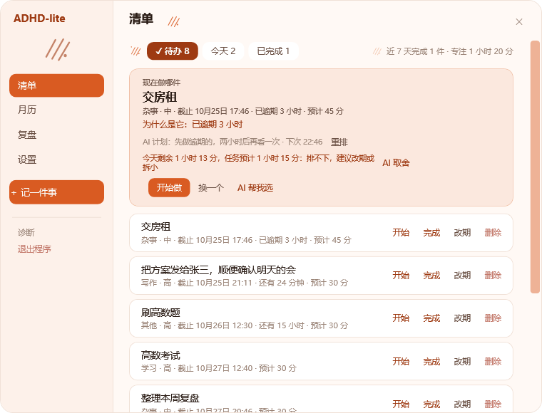

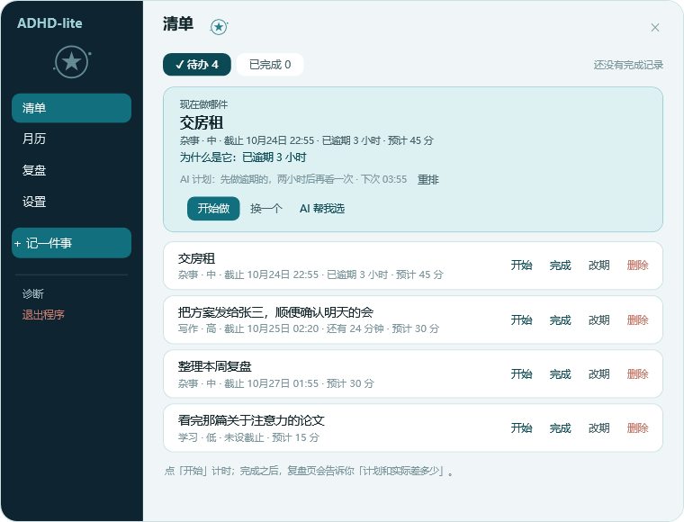

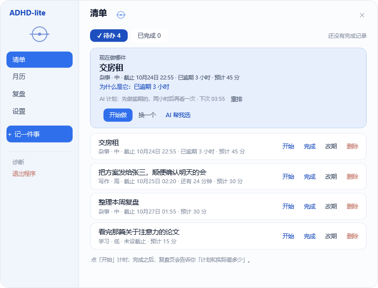

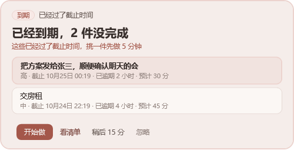

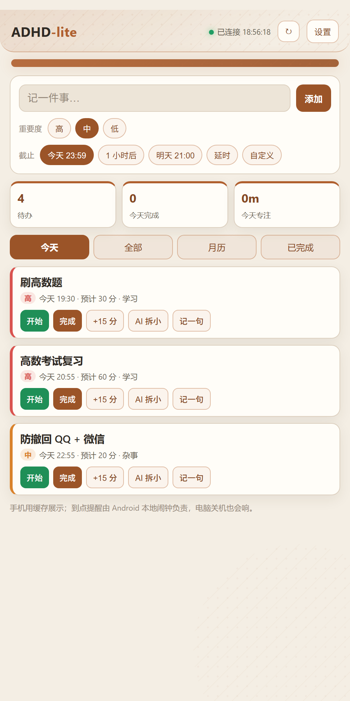

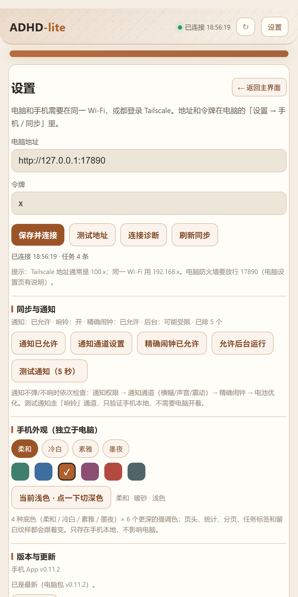

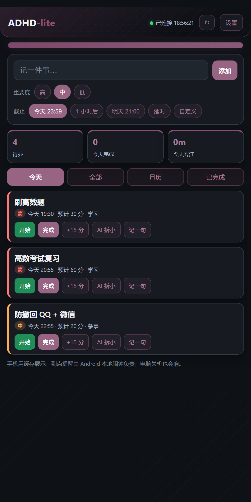

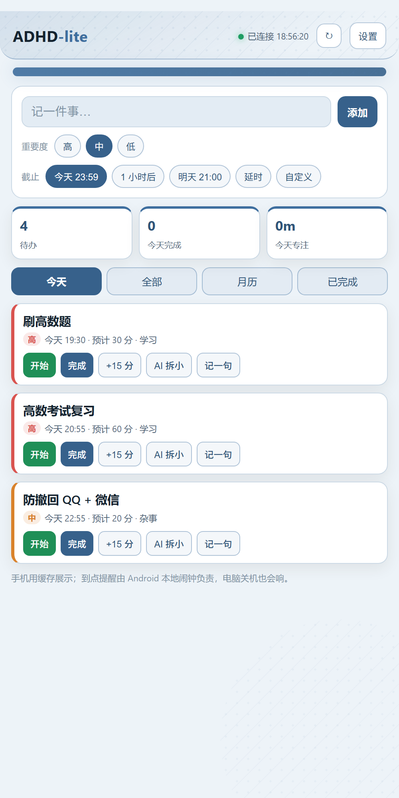

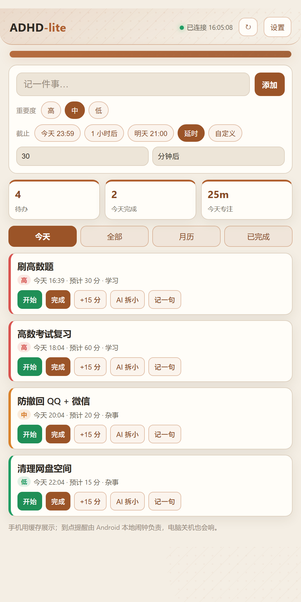

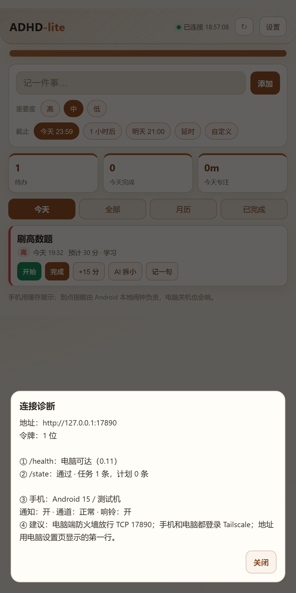

---

## 一、怎么启动

**双击 `ADHD-lite.exe`**，就这样。

启动 0.5 秒后会**自动弹出录入窗**，同时右下角托盘出现图标并冒一个气泡。

> **再次双击 exe ＝ 呼出录入窗**（它会通知正在运行的那份弹窗，自己不启动第二份）。所以即使全局热键不灵，你永远有一个能用的入口。
>
> 如果双击后弹出「已经有一个 ADHD-lite 在运行」并问你「要不要结束旧实例」——说明上次那份还活着（可能是旧版本），选「是」即可换成当前这份。

> 退出：录入窗右下角「退出」，或托盘图标右键 → 退出。

### 开机自启（v0.8）

主界面 →「设置」→「启动」→ 点一下「开机自启」：

- 只写当前用户的 `HKCU\Software\Microsoft\Windows\CurrentVersion\Run`，**不需要管理员**。
- 登录后带 `--startup` **静默启动**：不弹主界面、不冒气泡，只在托盘/悬浮球待命；按 `Ctrl+Num+` 或点悬浮球才出来。
- 移动 exe 位置后，下次启动会自动把 Run 项改成新路径，不用手动改注册表。
- 再点一下关闭；关闭只删除 `ADHD-lite` 这一个值，不碰别的启动项。
- 命令行手工写就是：`"<exe路径>" --startup`。

### 桌面悬浮球（新增，比托盘可靠）

屏幕右侧中间有一个**青绿色小圆球**：

- **点一下** → 打开录入窗
- **按住拖动** → 挪到任意位置
- **右键** → 打开录入窗 / 诊断 / 退出

这个是自己画的窗口，不依赖 Windows 通知区域，**一定会显示**。用来代替"找不到的托盘图标"。

### 托盘图标到底在哪

**任务栏最右边、时钟左边**（Win11 的话可能被折叠进时钟左边的 `^` 里，展开就能看到那个青绿色圆点）。

如果连 `^` 里也没有：右键任务栏 →「任务栏设置」→「其他系统托盘图标」，把 `ADHD-lite` 打开。

### 为什么是 exe 而不是脚本

`.cmd` / `.vbs` 启动方式被系统（火绒一类安全软件）拦截了——「wscript → PowerShell 隐藏窗口 → 执行脚本」正是恶意软件最典型的启动姿势，被杀软按规则毙掉很正常。

所以现在直接编译成 **原生 exe**：没有脚本宿主、没有隐藏的 PowerShell、没有 Chromium 子进程。编译用的是 Windows 自带的 csc 编译器（不需要装 .NET SDK / Visual Studio），程序集也全走系统自带的 .NET Framework 4.8。

| | Electron 版 | 脚本版 | **exe 版（现在）** |
|---|---|---|---|
| 能否在你机器上运行 | ❌ 0xC0000005 崩溃 | ❌ 被安全软件拦截 | ✅ 已验证 |
| 体积 | 370 MB | 30 KB | **331.5 KB**（桌面 exe；另 Android APK 约 40.6 KB） |
| 内存（实测） | 150–250 MB | 85 MB | **80 MB 空闲 / 135 MB 窗口打开** |
| 依赖 | 自带 Chromium | PowerShell + 脚本策略 | 无（系统自带 .NET 4.8） |

> 如果第一次运行弹出「Windows 已保护你的电脑」或火绒提示未知程序：这是**未签名**导致的误报，点「更多信息 → 仍要运行」，或在火绒里把这个 exe 加进信任区。它默认只往 `<exe目录>\data` 写 json；只有你主动打开「开机自启」时才写当前用户的 `HKCU` Run 项。平时不联网，只有你主动点 AI 功能时才连 DeepSeek。

### 绿色版 zip（v0.8）

`dist\ADHD-lite-v0.11.0-win64.zip` 里只有 `ADHD-lite.exe` + `使用说明.txt`，不包含 `data\`（没有你的任务和 Key），解压双击即用。

要重新打包：双击 `pack.cmd`（会先编译，再生成 zip），或先 `build.cmd` 后运行
`powershell -NoProfile -ExecutionPolicy Bypass -File tools\pack.ps1`。`dist\` 不进 git。

### Android 手机端（v0.11.2）

1. 手机安装 `android\dist\ADHD-lite-android-v0.11.2.apk`（允许未知来源；同 debug 签名可覆盖旧版）。
2. 首次打开允许通知；Android 12+ 再点「允许精确闹钟」，并把电池优化设为「不受限制」。
3. 电脑和手机都登录 **Tailscale**（推荐），或在同一 Wi-Fi。
4. 电脑：设置拉到最底部 →「手机 / 同步」→ 点亮开关，点「连接手机」展开地址和令牌，再填进手机 App。
   - Tailscale 地址是 `http://100.x.x.x:17890`；
   - 同一 Wi-Fi 是 `http://192.168.x.x:17890`。
5. 手机可以：看今天 / 全部 / 月历 / 已完成；加任务（今天 / 1 小时后 / 明天 / **延时** / 自定义日期时间）、完成、改期、开始/暂停计时、记一句、AI 拆小、AI 取舍。
   - 「延时」填数字 + 选「分钟后 / 小时后 / 秒后」，和桌面录入窗一致。
6. 手机外观：**4 种底色**（柔和 / 冷白 / 素雅 / 墨夜）× **6 个更深强调色**（青瓷 / 雾蓝 / 暖砂 / 梅子 / 赤陶 / 松烟）；页头、统计数字、分页、任务优先级标签、按钮和留白纹样都会跟着变色。默认「柔和 · 暖砂 · 浅色」，只存在手机本地，不影响电脑。
7. 设置页右上角有「← 返回主界面」，同步轮询不会再把你踢回主界面；Android 返回键也按「设置 → 主界面 → 今天 → 退出」的顺序走。
8. 设置页显示 **App 版本**；电脑端打包了新 APK 后，手机会出现「新版本」提示，点「下载并安装」即可。Android 不允许静默安装，系统还会再确认一次。
9. 设置页能看到通知权限、通知通道、是否响铃、精确闹钟、后台是否受限、已排闹钟数；「测试通知（5 秒）」走**响铃通道**，不需要电脑开着。
10. **点按反馈**：所有按钮/分页/任务/日历格按下会缩放变暗；完成/开始/暂停/改期会先显示「正在…」，成功后提示「已完成 / 已开始」等；正在同步时点按会提示“正在同步”，不再静默无反应。
11. **连接诊断**：设置页点「连接诊断」，会分开显示 `/health`（电脑是否可达）和 `/state`（令牌是否通过），再附手机通知状态；连不上时先看这里，不再只靠 toast。
12. AI 计划也会同步到手机，按计划时间由手机本地闹钟提醒；电脑关机也能响。

**提醒**：手机同步后会把截止时间写进 Android `AlarmManager`，由**手机本地**发通知，所以电脑关机也能响；手机重启后会自动重排。
**通知不弹 / 不响**：先看设置页的「通知 / 通道 / 响铃 / 精确闹钟 / 后台」；点「通知通道设置」把「横幅（悬浮通知）/ 声音 / 震动」都打开；Android 13+ 要允许通知，Android 12+ 要允许精确闹钟，国产系统还要把电池优化设为「不受限制」。

### 手机连不上电脑时（v0.11.2 已在本机加规则）

1. 电脑端 `ADHD-lite.exe` 要开着，设置里「手机同步」亮着；手机和电脑在同一 Wi-Fi 或都登录 Tailscale。
2. **Windows 防火墙**要放行 TCP 17890。管理员 PowerShell 执行一次：
   ```powershell
   New-NetFirewallRule -DisplayName "ADHD-lite mobile sync (TCP 17890)" -Direction Inbound -Protocol TCP -LocalPort 17890 -Action Allow -Profile Any -RemoteAddress 100.64.0.0/10,LocalSubnet
   ```
   这台机器已经加过这条规则；如果手机还是连不上，先在电脑浏览器打开 `http://127.0.0.1:17890/health` 确认服务在跑。
3. 手机地址填电脑设置页显示的 **第一行**（Tailscale `100.x`；同一 Wi-Fi `192.168.x`），不要填手机自己的 IP；令牌要完整复制。
4. 手机设置 →「连接诊断」：
   - `① /health` 失败 → 网络/地址/防火墙问题；
   - `①` 通过但 `② /state` 401 → 令牌不对；
   - 两项都通过但页面不刷新 → 看手机通知/缓存，或把诊断结果发我。
**离线**：断网时用缓存；完成/开始/暂停/改期/新增会进本地 outbox，回连后补发。
**不传 Key**：手机只拿任务数据，AI 请求转发到电脑端；`settings.json` 和 API Key 不会下发。

> 局域网 HTTP 只适合自己用；不要把这个端口直接暴露公网。Tailscale 本身加密。
>
> **其他人想用**：同一 Wi-Fi 下不需要 Tailscale，填电脑的 `192.168/10.x` 地址即可；如果要在外面用，对方手机也要装 Tailscale 并加入同一个 tailnet（或后续做公网中继）。当前是单一令牌，能连上的人都能读写全部任务，没有多用户权限。

### 别人想用 / 上传到 GitHub

**现在的架构不是云服务**：手机是客户端，读写的是某台正在运行的电脑上的 `ADHD-lite.exe`。所以：

- 别人要用，需要能访问到一台运行中的桌面端（同一 Wi-Fi、Tailscale，或以后做的公网中继），并填那台电脑的地址 + 令牌。
- 如果不想让别人碰你的电脑：让对方自己下载 `ADHD-lite.exe`，在自己的电脑上跑一份、填自己的 DeepSeek Key；手机连他自己的电脑。两边数据互不相通。
- 当前只有**一个令牌**，没有账号/多用户/访客权限；能连上的人都能读写全部任务。不要把 `17890` 直接暴露到公网。
- 想做成「大家共用一个服务」需要另外做服务端/中继；现在没有。

**能不能传到 GitHub**：可以，代码和 APK 都能放；注意：

- `data/` 里有你的 `settings.json`（API Key）和 `mobileToken`，已经在 `.gitignore`，**不要 `git add -f data/`**。
- `dist/` 也不进 git；APK 可以单独作为 GitHub Release 附件。
- `android/debug.keystore` 是调试签名，仓库里保留它是为了旧 APK 能覆盖升级；它不是你的 API Key。要更正式可以换成自己的 release keystore 重新签名。
- 上传后别人仍然要自己跑桌面端；GitHub 只放代码/安装包，不托管你的任务数据。

重新打 APK：

```powershell
powershell -NoProfile -ExecutionPolicy Bypass -File android\build-apk.ps1
```

需要 JDK + Android SDK 35；详细见 [android/README.md](android/README.md)。

### 启动后应该看到什么

1. **录入窗会自己弹出来**（屏幕中上，约 560×199）—— 这是最直接的"我起来了"信号
2. 右下角托盘出现一个青绿色圆点，并冒一个气泡「ADHD-lite 已启动 · 按 Ctrl+Num+ 记一件事」
3. 按 `Esc` 隐藏（点窗口外面不会自动消失）；之后按热键（或双击 exe / 点悬浮球）唤出

如果这时双击第二次，会弹一个提示框告诉你「已经在运行了」，不会静默无反应。

### 万一还是"双击没反应"

程序每次启动都会写日志，这是判断"没启动"还是"启动了但看不见"的唯一可靠办法：

```
%APPDATA%\adhd-lite\startup.log
```

- **文件不存在或为空** → exe 被拦住了（安全软件静默拦截），把拦截提示或软件名告诉我
- **有 `就绪：热键=...` 这行** → 程序在正常跑，问题只在显示（托盘被折叠／窗口跑到屏幕外）
- **有 `FATAL ...`** → 程序自己报错，把那几行发我

另外可以打开任务管理器 → 详细信息，看有没有 `ADHD-lite.exe` 进程。

---

## 二、怎么用

| 操作 | 说明 |
|---|---|
| `Ctrl+Num+` | 全局唤出录入窗（即按即弹；按住可重复触发是 Windows 的正常行为） |
| 打字 | 任务名称 |
| 点「今天 / 明天 / 5 分钟后 / 10 分钟后 / 自定义…」 | 设截止时间 |
| `Ctrl+1` / `Ctrl+2` / `Ctrl+3` | 高 / 中 / 低 重要度 |
| `Enter` | 保存并立刻消失 |
| `Esc` 或右下角「清单 / 快捷键」旁的空白 | 手动收起（**点窗口外面不会再自动消失**） |
| 右下角「清单」 | 打开主界面的清单页 |
| 右下角「快捷键」 | 打开录制器，按下想要的组合 → Enter 保存；`Esc` 只关录制器 |

- 截止时间默认：今天 = 今天 23:59；明天 = 明天 21:00；**5 分钟后 / 10 分钟后** = 当前时间 +5/+10 分钟。
- **「自定义」有两种方式，选一个再用**（选中的那个会实心高亮，一眼看得出当前用的是哪种）：
  - **延时**：填数字 + 单位（秒 / 分 / 时），例：`30 分 后提醒`、`90 秒 后提醒`
  - **指定日期**：填 `2026-10-25` + `21:00`
- **默认时间**（主界面 →「设置」→「默认时间」）：选「延时 30 分钟」之类，以后每次按快捷键唤出录入窗都会预选它，**写完标题直接回车就存进清单**，不用每次点。
- 按住顶部「记一件事」那一行可以拖动窗口。
- 中文输入法拼音上屏前按 Enter **不会误提交**（判断了 `ImeProcessed`）。

### 主界面

- 「清单」：待办 / **今天** / 已完成 三个分页；「今天」只显示今天到期和已逾期的待办，行内有 完成 / 改期 / 删除（已完成有 撤销）。
- 「改期」弹出：`5 分钟后` / `10 分钟后` / `1 小时后` / `自定义…` / `默认 · <你设置的默认时间>`。
  - 「自定义…」是个小窗：**先选「延时」还是「指定日期」（选中的实心打 ✓，只显示一组输入），最后按「确定」**。延时可以换 秒 / 分 / 时。
- 「月历」：
  - 显示当月，**格子里直接写任务标题**（最多 2 条，多出来的显示 `+N 件`），已完成的任务带 ✓ 和删除线
  - **点「2026 年 10 月 ▾」可以选年份和月份**（年份 ‹ › 加减、今年，12 个月一格一点）
  - 顶栏有 `回到今天` / `‹ 上个月` / `下个月 ›`
  - **点一下格子 = 选中那天**，下面列出那天的全部任务，每行都能 **编辑 / 改期 / 完成 / 删除**（编辑可改标题和重要度）
  - **「＋ 记在 10 月 24 日」是主色实心按钮**（第二行左侧，一直可见）：点它 = 打开录入窗并预填那天的日期，写完标题回车就落到那天
- **窗口可以拖四周边缘或四角放大缩小**（无边框窗口，8 个方向都做了热区，鼠标移到边缘光标会变）。左上角区域可拖动窗口。
- 「设置」：快捷键 / 默认时间 / **主题（风格 + 颜色）** / 智能助手 / 数据目录 / 诊断 / 退出。

### 执行闭环（v0.5）：开始做 → 计时 → 复盘

清单页最上面是「现在做哪件」：

- 排序先看 **逾期 > 今天到期 > 重要度 > 预计时长**，再叠加你的习惯（高效时段、推迟次数、放置天数）。
- 「开始做」开始计时；「换一个」看下一条；「AI 帮我选」让 DeepSeek 在候选里挑一条，给一句理由 + 一个 2 分钟内能开始的动作（失败自动退回本地规则）。
- 开始后顶部变成「正在做」条：实时计时、剩余时间、超时提示，按钮 `完成 / 暂停 / 记一句 / 卡住了`。
  - `记一句`：写下"做到哪了"，下次推荐到它时会显示。
  - `卡住了`：AI 给一个 2 分钟内能开始的具体动作（填了 Key 才出现）。
- 完成后弹一句「专注 23 分钟 · 预计 30 分，多了 3 分 · 今天第 3 件」，并把实际用时写进任务。

左侧新增「复盘」：

- 近 7 天：完成数 / 专注分钟 / 按时率 / 计划偏差
- 「AI 解读」：把完成、超时、时段发给 DeepSeek，给 2–3 句「一个模式 + 一个下次可执行的调整」；结论会存下来，之后选任务、拆解、稍后建议都会带上。
- 习惯画像：每个重要度的平均实际 vs 预计、完成时段、连续天数
- 最近完成：每条任务的「预计 → 实际」和是否按时

**反馈怎么影响下一次：**

- 新建任务的预计用时 = 重要度基础值 × 你的历史偏差（至少 2 条记录后生效），在「编辑」里可改。
- 推荐顺序会偏向你历史上更容易完成的时段，并优先捞起被推迟多次的任务。
- 稍后时长会在你经常超时 40% 以上时自动加 5 分钟；开了 AI 决策则把历史一起发给它。
- AI 拆解会把「你的超时比例 / 当前负担 / 上次复盘结论」写进提示词，不再给千篇一律的估计。
- 统计全部从 `tasks.json` 的真实 `createdAt / startedAt / spentMs / doneAt` 算出来，没有另一份需要维护的数据。

### AI 推进提醒（v0.6）：截止前自己挑时间，到期后汇总

- **怎么排**：启动后 / 任务有变化时，AI 会看你的清单、重要度、截止时间、历史超时和高效时段，决定接下来 12 小时在哪几个时间点提醒；最多 6 条，同一任务至少隔 1 小时，**23:00–07:00 默认不提醒**（挪到 07:15；只有「高优先 + 3 小时内截止」例外，允许在截止前再提醒一次）。
- **在哪看**：「现在做哪件」卡片下面会显示 `AI 计划：… · 下次 14:30`；点「重排」可以立刻重来。AI 失败 / 没填 Key 时自动用本地规则（按截止时间往前推 60–90 分钟）。
- **到点弹什么**：不是只弹一条任务，而是 **汇总窗**：「还有 3 件没做完」+ 最该做的 1 件（高亮）+ 另外 2 件 + AI 一句话；按钮 `开始做 / 看清单 / 稍后 15 分 / 忽略`。
- **到期后**：到点后 10 分钟内，弹 **「已经到期，N 件没完成」** 汇总，列出真正过期的任务；同一个任务一天只汇总一次，不会每 30 秒烦你。
- **旧固定提醒怎么办**：AI 计划生效时，原来「前一天 20:00 / 当天 09:00 / 前 2 小时」的逐条提醒不再弹（避免和汇总撞车）；你手动点的 `稍后` 仍然一定弹。关掉「AI 安排提醒时间」就回到旧规则。

**高 / 中 / 低三套弹窗**（提醒窗和汇总窗都按焦点任务的重要度切换）：

| 级别 | 视觉 | 文案 | 按钮 |
|---|---|---|---|
| 高 | 520px、2px 红棕描边、徽章「重要」 | 「现在最该处理」+ 强提示「先做 5 分钟」 | `开始做` 红色实心 / `完成` / `稍后 10 分` / `自定义` / `忽略` |
| 中 | 480px、主题描边、徽章「提醒」 | 原来的「还有 2 小时」 | `开始做` / `完成` / `稍后 15 分` / `自定义` / `忽略` |
| 低 | 440px、灰描边、徽章「顺手」 | 「不急，顺手做掉」 | 只有 `完成` / `稍后 30 分` / `忽略`（不鼓励为小事开计时） |

### 主题（风格 + 颜色）

两级选择：**先选风格，再选这个风格里的颜色**，共 5 风格 × 4 色 = 20 套。

| 风格 | 颜色 | 主色 | 整体感觉 |
|---|---|---|---|
| **柔和** | 青瓷 | 墨绿 `#4F8A78` | 暖米白底 + 绿 |
| | 雾蓝 | 靛蓝 `#4E7CA6` | 暖米白底 + 蓝 |
| | 暖砂 | 赭 `#B5764A` | 米黄底 + 陶土色 |
| | 梅子 | 梅紫 `#9A6A88` | 淡粉底 + 梅紫 |
| **冷白** | 雪松 | 深松绿 `#2F7D5E` | 冷白底 + 深松绿（松树纹）|
| | 冰蓝 | 钢蓝 `#3E7FB8` | 冷白底 + 钢蓝（雪花纹）|
| | 石板 | 石板灰蓝 `#525C6B` | **深冷灰底**（对比最强）+ 石板灰（山纹）|
| | 雾灰 | 雾蓝灰 `#71848B` | 冷灰底 + 雾蓝灰（雾纹，和雪松的绿拉开）|
| **素雅** | 豆沙 | 陶红 `#A8695F` | 米灰底 + 豆沙 |
| | 苔绿 | 苔绿 `#7A8A5E` | 米灰底 + 苔绿（竹纹）|
| | 灰紫 | 灰紫 `#7A6B92` | 米灰底 + 灰紫 |
| | 松烟 | 松烟青 `#566A6E` | 灰底 + 松烟青 |
| **科幻** | 星舰 | 冷光青 `#12707E` | **深蓝侧栏** + 冷白内容 + 轨道星图 |
| | 深空 | 靛紫 `#5B63C8` | 深蓝紫侧栏 + 冷白 |
| | 极光 | 极光绿 `#2E8B6F` | 墨绿侧栏 + 冷白 |
| | 矩阵 | 终端橄榄 `#5F6B1E` | 墨绿黑侧栏 + 电路纹 |
| **简约** | 蓝白 | 经典蓝 `#2F6FEB` | 浅蓝侧栏 + 纯白（经典蓝白）|
| | 黑白 | 墨黑 `#262A30` | 浅灰侧栏 + 纯白 |
| | 橙白 | 亮橙 `#D95B22` | 暖白侧栏 + 纯白（橙白）|
| | 绿白 | 翡翠 `#0B8A5F` | 薄荷侧栏 + 纯白（绿白）|

- 每个颜色带一整套 token：主色 / 浅底 / 描边 / 深色 / 窗口底 / 卡片底 / 主文字 / 次文字 / 弱文字 / 分隔线 / **侧栏底**，所以换颜色是**整页一起变**（侧栏、品牌字 `ADHD-lite`、行卡片、标题、边框、录入窗、提醒窗、右键菜单都会跟着）。
- **科幻 / 简约的侧栏有独立底色**（深蓝、浅蓝、浅灰等），和右侧内容区同风格但不同色；深色侧栏会自动切浅色导航字。
- 侧栏、页面标题、**录入窗右上角（64px）**、**设置页右侧留白**、清单统计行/空态都有对应纹样：松树、雪花、山、雾、竹、梅、陶罐、枝、太阳、雨滴、轨道、行星、波、电路、圆环、网格、斜线、点阵；纯矢量绘制，不依赖图片。
- 选中的风格/颜色是**深主色实心 + ✓**，鼠标移开也不会掉。

### 提醒规则

| 重要度 | 什么时候提醒 |
|---|---|
| 全部 | **到点了**（截止时间那一刻） |
| 高 | 截止前一天 20:00 / 当天 09:00 / 截止前 2 小时 |
| 中 | 当天 09:00 / 截止前 2 小时 |
| 低 | 当天 09:00 |
| 已逾期 | 每天第一次检查时提醒一次 |

> 这张表是**关掉「AI 安排提醒时间」**时的旧固定规则；开着时由上面的 AI 计划接管，截止前的逐条提醒不再弹，避免和汇总撞车。
> **v0.10.1 修复**：AI 计划生效时「到点了」不再被一起吞掉；即使 AI 计划没覆盖截止时刻，也会正常弹到期提醒。
>
> 已经过去的时间点会自动跳过，所以「5 分钟后」这种任务在旧规则下只会剩「到点了」这一个提醒。

- 提醒窗**固定在屏幕正中弹出**（窗口本身还能拖动），`ShowActivated=False` **不抢焦点**，不会把你从游戏/编辑器里顶出去。
- 提醒窗里可以：`开始做` / `完成`（Enter）/ `稍后 N 分钟` / **`自定义…`**（自己填延时 + 秒/分/时；**打开时数字就是全选状态**，直接敲数字覆盖，点进输入框也会全选）/ `忽略`（Esc）。
- **标题下面那行小字按重要度变**：高＝"先做 5 分钟，开了头就不难"；中＝"有空档就往前推一点"；低＝"顺手做掉"；逾期＝"改期或者现在做掉"。
- **稍后时长也按重要度**：高 10 分钟 / 中 15 分钟 / 低 30 分钟；本来 5 分钟内的短任务给 5 分钟；23 点后至少 1 小时。
- **稍后 / 改期 之后一定会再提醒**：你主动指定的时间点会把自己今天的提醒额度清零，并且按毫秒级定时（不再等 30 秒心跳）。
- **点完「确定」不会又被顶回来**：稍后之后把"今天已提醒过逾期"标记上，30 秒心跳不会再把同一个任务弹一遍。
- **同一任务一天最多弹 2 次**（`DAILY_LIMIT`，只在关掉 AI 计划 / 走旧固定提醒时生效）。
- **AI 计划生效时**：截止前由汇总提醒接管，到期后由「到期汇总」接管；同一条任务不会既弹旧提醒又弹汇总。
- 程序没开就不会提醒（没做后台服务，这是为了不常驻资源）。

---

## 三、智能助手（v0.4 → v0.6 · DeepSeek）

> 全部是**可选**的：不填 Key 也能正常记任务、提醒，AI 功能自动退回本地规则。

### 怎么开

1. 悬浮球右键 →「任务清单」→ 左侧「设置」→ 拉到「智能助手（DeepSeek）」
2. 填 **Key**（只存在本地 `data\settings.json`，不会发给别人）、模型默认 `deepseek-flash`、地址默认 `https://api.deepseek.com`
3. 点「测试连接」，下面那行会显示"连接成功 / 失败原因"
4. 四个开关：**「录入窗显示 AI 拆解」**、**「让 AI 决定稍后时长」**、**「清单页用 AI 帮我选」**、**「AI 安排提醒时间」**

### AI 助理（v0.7 → v0.8）

| 能力 | 怎么用 | 没 Key 时 |
|---|---|---|
| **一句话拆解** | 录入窗里写一句话（如"周五前把方案发给张三"），点页脚 **`AI 拆解`** → 弹出 1–4 个子任务（标题 / 类型 / 重要度 / 几分钟后 / 预计用时），勾选后「全部加入」；会参考你的历史超时和当前负担 | 按钮点了会提示先去填 Key |
| **AI 安排提醒** | 启动 / 任务变化后，AI 决定接下来 12 小时的提醒时间点；到点弹「还有 N 件没做完」汇总，到期后弹「已经到期」汇总 | ✅ 本地按截止时间往前 60–90 分钟兜底 |
| **拖延任务拆小** | 一条任务被稍后/改期 ≥2 次后，行内出现 `拆小`：AI 拆成 2–3 个更小步骤，可勾选后 **替换原任务** | 按钮不显示 |
| **AI 取舍** | 今天预计任务超过剩余时间时，「现在做哪件」下面出现红字超载提示 + `AI 取舍`：说清楚先做哪件、哪件改期/拆小 | 只有本地超载提示 |
| **回到任务下一步** | 任务带「记一句」再点开始时，AI 用上次进度生成一句「下一步」，显示在「正在做」条 | 显示你原来的「上次：…」 |
| **按类型学习** | 任务自动分写作/代码/沟通/杂事/学习/其他；复盘里按类型比较「预计 vs 实际」，估时优先用同类历史 | ✅ 本地关键词分类 |
| **个人规则** | AI 复盘会额外提炼一条规则（如「下午不排高认知任务」）存下来，之后的排提醒/拆解/取舍都会带上 | 无（可手动在复盘页看规则） |
| **查重 / 含糊** | 录入时发现类似任务会先拦一次「再按 Enter 仍要添加」；太短的标题会提示补一句下一步 | ✅ 本地规则，不联网 |
| **提醒文案按重要度分级** | 提醒窗标题下面那行小字，高 / 中 / 低 / 逾期各一套措辞；高/中/低三套视觉与按钮也不同 | ✅ 本地模板，不联网也生效 |
| **稍后提醒智能决策** | 提醒窗的「稍后 N 分钟」默认值按重要度算（高 10 / 中 15 / 低 30）；开了开关会把你的历史一起发给 AI，按钮显示「稍后 N 分钟（AI）」 | ✅ 本地规则兜底 |
| **AI 帮我选** | 清单页「现在做哪件」卡片 → `AI 帮我选`：在候选里挑一条，给一句理由 + 一个 2 分钟内能开始的动作 | 按钮不显示，本地排序照常 |
| **卡住了** | 「正在做」条上点 `卡住了`：按当前任务、已做时长、上次备注给一个 2 分钟动作 | 按钮不显示 |
| **AI 复盘** | 左侧「复盘」→ `让 AI 看看这周`：根据近 7 天完成 / 超时 / 时段给 2–3 句模式 + 调整，并提炼一条个人规则 | 按钮提示先填 Key |

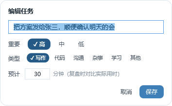

> **v0.8 的 prompt 调整**：`拆小`会带原截止时间，要求第一步 2 分钟内能动手、步骤以动词开头；
> `AI 取舍`只把今天到期/逾期的任务放进 prompt（未来任务只报数量），要求固定 2–3 句：先做哪件、哪件改期/拆小、今天不做什么。
> 原始返回会写进 `startup.log` 的 `AI 拆小 raw` / `AI 取舍 raw` / `AI 下一步 raw`，方便按实际输出再调。

### 什么时候会花额度

| 动作 | 调用次数 | 大概 token |
|---|---|---|
| 点一次「AI 拆解」 | 1 次 | ~350 输入 + ~200 输出 |
| 点一次「拆小」 | 1 次 | ~400 输入 + ~200 输出 |
| 点一次「AI 取舍」 | 1 次 | ~500 输入 + ~100 输出 |
| 开始一条带备注的任务（生成下一步） | 每个任务首次 1 次 | ~350 输入 + ~40 输出 |
| 点一次「AI 帮我选」 | 1 次 | ~400 输入 + ~80 输出 |
| 点一次「卡住了」 | 1 次 | ~350 输入 + ~40 输出 |
| 点一次「让 AI 看看这周」 | 1 次 | ~600 输入 + ~150 输出（含规则）|
| 开着「让 AI 决定稍后时长」时，提醒窗每弹一次 | 1 次 | ~250 输入 + ~5 输出 |
| 「AI 安排提醒时间」自动重排 | 启动 / 任务变化 / 12 小时过期，最多约 1 次/3 分钟 | ~550 输入 + ~160 输出 |
| 点一次「测试连接」 | 1 次 | 几十 token |
| `--ai-smoke` 六项全测 | 6 次 | 约 ¥0.006（用临时目录，不碰真实清单） |
| 手机点一次「AI 拆小 / AI 取舍」 | 1 次 | 与桌面同价；由电脑端用 Key 调用 |

> 类型分类、查重/含糊、超载计算、习惯统计都是**本地**的，不花钱。
> 其余按官方价（`deepseek-flash`，2026-10 页面价：输入未命中 2/1 元、输出 8/4 元每百万 token，高峰/空闲）：
> 拆解/拆小约 **0.002 元**，选任务/下一步/卡住约 **0.001 元**，复盘/排提醒/取舍约 **0.002–0.003 元**。
>
> **一个月大概**：轻度（只用计划+偶尔点）约 **¥0.2**；正常自用约 **¥0.6–1.0**；重度（拆小/取舍/下一步天天用）约 **¥1.5–2.5**。
> 类型/查重/超载/统计是本地，¥0；夜间 00:30–08:30 空闲价约半价。

### 说明

- 调用是 **HTTPS 直连** `POST {地址}/chat/completions`，超时 25 秒，失败会在录入窗/设置页/卡片上给出原因，并写进 `startup.log`。
- 只有你**主动点** AI 按钮、开着「AI 决定稍后时长」或开着「AI 安排提醒时间」时才会联网；关掉「AI 安排提醒时间」就完全不自动联网。
- 排提醒 / 选任务 / 拆解 / 拆小 / 取舍 / 下一步 / 复盘会把**统计、任务标题、类型和个人规则**发给 DeepSeek（不发送 API Key、不做屏幕截图、不读别的窗口）；提醒计划存在本地 `data\pushplan.json`，复盘结论/规则存在 `settings.json`。
- 「AI 拆解」返回的每个子任务会按 AI 给的 `delayMinutes` 换算成截止时间、按 `estimateMinutes` 记预计用时，并照常生成分级提醒点。
- 默认模型名用文档里的 `deepseek-flash`（旧的 `deepseek-chat` 名字已下线）；要换 `deepseek-v4-pro` 之类，直接在设置页改模型名。

---

## 四、数据

| 内容 | 位置 |
|---|---|
| 任务数据 | **`<exe 所在目录>\data\tasks.json`**（默认，绿色便携） |
| 快捷键设置 | `<exe 目录>\data\settings.json` |
| 提醒计划 | `<exe 目录>\data\pushplan.json`（删掉会重新排；AI 失败时是本地计划） |
| 启动日志 | `<exe 目录>\data\startup.log` |
| 自检日志 | 测试模式：`%TEMP%\adhd-selftest-home\diagnostics.log`；正常启动/截图：`<exe 目录>\data\diagnostics.log` |
| 手机同步 | **不另存**：手机读写同一份 `tasks.json`；端口/令牌在 `settings.json` |

> v0.5 起 `tasks.json` 每条任务多了 `startedAt / spentMs / estimateMin / lastNote / snoozeCount / postponeCount`；
> v0.7 又多了 `kind`（类型）和 `resumeHint`（AI 下一步）。复盘页的统计直接从这些真实字段算，**不另存统计文件**。
> v0.8 的 `settings.json` 升到 `ver=9`，多了 `autoStart`；**`startup.log` 里的 API Key 现在会写成 `***`**，不再明文落日志。
> v0.10 升到 `ver=10`，多了 `mobileOn / mobilePort / mobileToken`；日志里的 `aiKey` 和 `mobileToken` 都会脱敏。
> AI 复盘结论存在 `settings.json` 的 `lastInsight`，个人规则存在 `rules`。

> 程序启动时会依次试 `ADHD_HOME` → **`<exe目录>\data`** → `%APPDATA%\adhd-lite` → `%TEMP%\adhd-lite`，
> 每个都做一次真实写入测试，能写才用。
> 你这台机器上 `%APPDATA%` 写不进去（所以之前日志和设置都"凭空消失"），现在会自动落到 exe 旁边的 `data\` 里。
> 实际用了哪个目录，点录入窗右下角「**诊断**」就能看到。

---

## 五、关于快捷键

- 默认是 **`Ctrl+`小键盘`+`**（VK_ADD）。想要主键盘的 `=` 键，点「快捷键」自己录一个即可。
- **启动时就会注册**（不用先打开录入窗），所以开机后按快捷键一定能叫出录入窗。
- **换配色不会再改掉你的快捷键**（以前保存设置会把还没注册的 0 写进文件，导致下次启动变成 `Ctrl+=`；现在只有你亲自录制才会写入）。
- 如果 `data\settings.json` 里的热键被写坏了（VK00），启动时会自动修回 `Ctrl+Num+`。
- **想换**：录入窗右下角点「快捷键」→ 按下想要的组合 → Enter 保存。会浮出一个与界面同风格的轻提示，写进 `data\settings.json`，重启后保持。
- 如果开机时你设的组合被别的软件抢先占了，程序会先临时降级，右上角标「**（临时）**」，并**每 8 秒重试一次**，抢回来后自动切回并提示「快捷键已恢复」。
- 实测这台机器上 **`Ctrl+Alt+A`（QQ 截图）和 `Ctrl+Shift+Space` 已被别的软件占用**，别再选这两个。
- ⚠️ 全局热键会吃掉所有程序里的这个组合键。
- 按了没反应时点「诊断」：能看到「用户设置 = X / 当前实际 = Y」，一眼看出是不是被降级了。

---

## 六、自检（想确认它没坏就跑这个）

```powershell
# 在项目目录打开 PowerShell
.\ADHD-lite.exe --selftest         # 记一条任务，校验落盘 / 提醒点 / 计时 / 推荐
Get-Content "$env:TEMP\adhd-selftest-home\diagnostics.log"
```

看到 `SELFTEST_OK`、4 个提醒点、`START-FINISH OK`、`PLAN-LOCAL OK`、`KIND-GUESS OK`、`AUTOSTART-CMD OK`、`LOG-MASK OK`、`TRIAGE-PROMPT OK` 就说明核心链路正常（共 46 行，0 FAIL）。

> **v0.8 起自检会自动隔离**：`--selftest` / `--ui-selftest` / `--ai-smoke` 用 `%TEMP%\adhd-selftest-home`，
> 只复制 `settings.json`（为了 Key / 主题），**不读写真实 `data\tasks.json`、`pushplan.json`，也不写开机自启**。
> 显式设了 `ADHD_HOME` 时仍按你指定的目录走。

另外两个自检会把窗口渲染成 PNG（只渲染自己，不碰桌面）：

```powershell
.\ADHD-lite.exe --snapshot shot.png              # 录入窗
.\ADHD-lite.exe --snapshot shot.png custom        # 录入窗 + 自定义延时模式
.\ADHD-lite.exe --reminder-shot rem.png          # 提醒窗（默认高；第三参数 high / mid / low）
.\ADHD-lite.exe --digest-shot dg.png overdue     # 汇总窗（nudge / overdue / high / mid / low）
.\ADHD-lite.exe --main-shot main.png             # 主界面（文件名含 settings / calendar / review / 设置 / 月历 / 复盘；含 active / 正在做 则渲染计时条）
.\ADHD-lite.exe --dialog-shot dlg.png resched    # 改期/延时/编辑窗（resched-date / delay / edit）
```

还有两个"自动化交互自检"（不需要手点，结果写到 `data\diagnostics.log`）：

```powershell
.\ADHD-lite.exe --ui-selftest
#   RESIZE-DRAG  模拟拖右边缘（光标被别的程序占用时会 SKIP）
#   RESIZE-LOGIC 直接验证缩放数学（总会跑）
#   PRIORITY     触发"高"按钮的 Click，确认 priority 真的变了
#   DRAG-WALK    点按钮里的文字不再抛异常（曾导致"重要程度点不动"）
#   HABIT-CARD   清单顶部有「现在做哪件」
#   TAB-HIGHLIGHT 分页选中态经 MouseEnter/Leave 后仍在
#   ACTIVE-BAR   开始计时后出现「正在做」条和预计时间
#   DIGEST-UI / PLAN-FIRE / DIGEST-OVERDUE  汇总窗、计划到点、到期汇总
```

真实 AI 动作测试（会花大约 ¥0.006，用演示任务，不碰真实清单）：

```powershell
Start-Process .\ADHD-lite.exe -ArgumentList '--ai-smoke' -Wait
Get-Content "$env:TEMP\adhd-selftest-home\diagnostics.log" | Select-String 'AI-SMOKE'
```

它会依次测：AI 选任务 / 复盘 / 卡住 / 拆小 / 取舍 / 下一步，
把每项原始返回写进 `AI-SMOKE-*` 行；主程序开着也能跑（命令行模式不参与单实例锁）。
Agent 沙箱里 TLS 拿不到凭证会 6 项全失败，这是环境限制，正常双击/正常 PowerShell 不受影响。

---

## 七、文件结构

```
ADHD-lite.exe        程序本体（双击即用）
build.cmd            改完代码后重新编译（Program.cs + Ui.cs + MainWindow.cs + Ai.cs + Habit.cs + PushPlan.cs + Deco.cs + Assist.cs）
pack.cmd             编译 + 打绿色版 zip（调用 tools\pack.ps1，产物进 dist\）
dist\                绿色版 zip（不进 git）
src\Program.cs       全部逻辑：窗口 / 热键 / 调度 / 存储 / 自检（C# 5）
src\MainWindow.cs    主界面：清单 / 月历 / 复盘 / 设置（与 Program.cs 用 partial 合并）
src\Habit.cs         v0.5 执行闭环：计时 / 习惯统计 / 按习惯推荐
src\PushPlan.cs      v0.6 AI 提醒计划：排时间 / 汇总弹窗 / 到期汇总 / 分级视觉
src\Deco.cs          v0.7 主题纹样：松树 / 竹 / 梅 / 轨道 / 电路 / 简约圆环
src\Assist.cs        v0.7 AI 助理：类型 / 超载 / 拆小 / 下一步 / 规则 / 查重
src\MobileServer.cs  v0.10 手机同步：TcpListener HTTP API / 令牌 / 任务读写 / AI 转发
src\Ai.cs            DeepSeek 调用 / 拆解 / 选任务 / 卡住求救 / 复盘 / 排提醒 / 本地兜底
android\             Android 客户端源码 + APK（见 android\README.md）
src\Ui.cs            由 ui\*.xaml 生成的界面资源（自动生成，勿手改）
ui\popup.xaml        录入窗界面
ui\reminder.xaml     提醒窗界面（含「开始做」）
tools\gen-ui.ps1     改完 ui\*.xaml 后跑它重新生成 src\Ui.cs
tools\pack.ps1       生成 dist\ADHD-lite-v0.11.0-win64.zip（pack.cmd 调用）
docs\                界面截图 + 现状与剩余任务.md + 题目对照.md
_script_fallback\    被拦截的 PowerShell 脚本版（可删）
_electron_fallback\  跑不起来的 Electron 版（可删，省 369 MB）
```

---

## 八、版本进度

| 版本 | 内容 | 状态 |
|---|---|---|
| v0.1 | 快捷键捕获 + 分级提醒 + 悬浮球 + 诊断 | ✅ 已完成 |
| v0.2 | 清单页：逾期/今日/重要度排序，完成 / 改期 / 删除 / 撤销，任务栏可见 | ✅ 已完成 |
| v0.3 | 主界面 + 月历 + 设置页 + 主题（风格×颜色）+ 窗口缩放 | ✅ 已完成 |
| v0.4 | 接 DeepSeek：一句话拆解任务、提醒文案按重要度分级、稍后提醒智能决策 | ✅ 已完成（没 Key 自动走本地规则） |
| **v0.5** | **执行闭环：开始/暂停/完成计时、现在做哪件、AI 选任务、卡住求救、复盘页、习惯画像、按历史估时** | ✅ 已完成 |
| **v0.6** | **AI 推进提醒：截止前自己排时间点、到点汇总"还有哪些没做"、到期汇总没完成、高/中/低三套弹窗** | ✅ 已完成 |
| **v0.7** | **5 风格 × 4 色（科幻/简约蓝白）、侧栏独立配色、主题纹样；AI 拆小/取舍/下一步/类型/规则/查重** | ✅ 已完成 |
| **v0.8** | **开机自启（登录静默启动）+ 绿色版 zip；自检完全隔离、API Key 日志脱敏、AI 拆小/取舍 prompt 收紧、AI smoke 六项** | ✅ 已完成 |
| **v0.10** | **Android 手机端：Tailscale/局域网同步、手机本地 AlarmManager 提醒、离线 outbox、手机 AI 拆解/取舍** | ✅ 已完成 |
| **v0.10.1** | **手机独立主题色/深浅色、自定义日期、月历、AI 计划本地通知；桌面「今天」筛选；手机连接设置收到底部** | ✅ 已完成（APK 28.5 KB） |
| **v0.11.0** | **手机 5 风格 × 4 色（默认浅色）、设置返回键/不再自动跳回、版本显示 + 从电脑一键更新、锁屏可见/电池优化入口** | ✅ 已完成（桌面 331.5 KB + APK 36.6 KB） |
| **v0.11.1** | **手机「延时」截止；柔和简约底 + 6 强调色/纹样；响铃通道 + 通知通道设置；测试通知改 5 秒直发** | ✅ 已完成（APK 40.6 KB / versionCode 13） |
| **v0.11.2** | **4 底色 × 6 色；点按/操作中/完成反馈；连接诊断；Windows 防火墙 17890 规则** | ✅ 已完成（APK 40.6 KB / versionCode 14） |
| v0.12 | markdown 原生存储 / 手机离线冲突合并 / 手机通知「完成」动作 | 待做 |

### 清单页怎么打开

- 小绿球右键 →「任务清单」
- 打开后会在**任务栏**留一个按钮（托盘不灵时的兜底入口）

列表排序：**逾期 → 今天 → 三天内 → 以后 → 无截止**，同组内重要度高在前、再按截止时间由近到远。
「现在做哪件」是另一套打分：在上面的基础上叠加你的高效时段、推迟次数、放置天数、预计时长。
